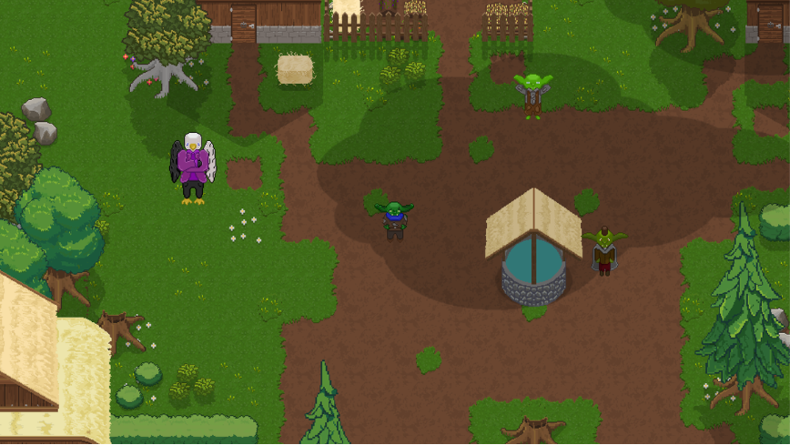

---
# Second example project. Copy this file to create your own:
# rename it, change the frontmatter, write the body. That is all.

title_fr: DestinyOfGobo
title_en: DestinyOfGobo

summary_fr: RPG tour par tour
summary_en: Turn based RPG

alt_fr: _
alt_en: _

image: ./DestinyOfGobo/DestinyOfGoboIcon.jpg

tags: [C, CSFML]

date: 2024-01-01

repo: https://www.creajeux.fr/projet/destiny-of-gobo/
---

<!--==================================================
  The Game
==================================================-->
<!-- lang:fr -->
## Le Jeu

Destiny of Gobo est un jeu de type RPG tour par tour, développé en CSFML et disponible uniquement sur PC.
Le jeu se base autour de la résolution d'énigmes présentes à plusieurs endroits et de combats en tour par tour afin de sauver le village.

Mon travail effectué sur ce projet :
- Création de l'architecture du jeu, afin de faciliter le développement et l'intégration de nouvelles features.
- Création du système d'animation
- Créations des menus et options
- Gestion et écritures des sauvegardes
- Création des PNJ, quêtes et dialogues ; ainsi qu'un système de création des PNJ et dialogues simplifié à l'aide de fichiers .txt
- Création du menu de changement de map, et gestion des changements de map
- Aide à la création des énigmes
- Aide à l'intégration des différentes features du jeu
- Aide à la création de l'inventaire

En cours d'écriture…

<!-- /lang -->
<!-- lang:en -->
## Le Jeu

Destiny of Gobo is a turn-based RPG developed in CSFML and available exclusively on PC.
The game revolves around solving puzzles found in various locations and engaging in turn-based combat to save the village.

My contributions to this project:
- Designing the game architecture to facilitate development and the integration of new features.
- Creating the animation system
- Designing the menus and options
- Managing and implementing save files
- Created NPCs, quests, and dialogues; as well as a simplified system for creating NPCs and dialogues using .txt files
- Created the map-switching menu and managed map transitions
- Assisted with puzzle design
- Assisted with the integration of various game features
- Assisted with the creation of the inventory

Currently being written...

<!-- /lang -->