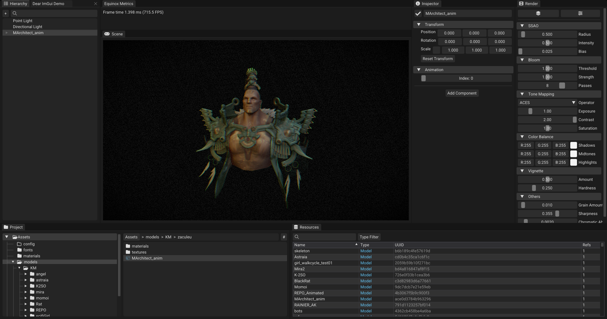

<!--==================================================
  The Project
==================================================-->
<!-- lang:fr -->
## Le projet

Equinox est un moteur de jeu 3D que je développe en **C++20**, avec un renderer **Vulkan 1.3**, un système de jobs multithread et un éditeur intégré construit avec Dear ImGui. Le dépôt compte aujourd'hui plus de 20 000 lignes de C++.

L'objectif n'est pas de concurrencer les moteurs existants, mais de comprendre et de mettre en pratique l'architecture d'un moteur moderne, en construisant chaque brique moi-même : parallélisme, rendu bas niveau, gestion de la mémoire et outils de production.

Je m'appuie sur plusieurs références :

- le moteur open source [Luth](https://github.com/Hekbas/Luth), qui me sert de modèle pour structurer mon code et pour ma feuille de route ;
- le moteur [Hazel](https://github.com/TheCherno/Hazel) de The Cherno, pour l'organisation générale du moteur ;
- **Unity**, pour la présentation de l'éditeur.
<!-- /lang -->
<!-- lang:en -->
## The project

Equinox is a 3D game engine I am building in **C++20**, with a **Vulkan 1.3** renderer, a multithreaded job system and an integrated editor built with Dear ImGui. The repository currently contains more than 20,000 lines of C++.

The goal is not to compete with existing engines, but to understand and apply the architecture of a modern engine by building each part myself: parallelism, low-level rendering, memory management and production tools.

I rely on several references:

- the open-source engine [Luth](https://github.com/Hekbas/Luth), which I use as a model to structure my code and my roadmap;
- The Cherno's [Hazel](https://github.com/TheCherno/Hazel) engine, for the overall organisation of the engine;
- **Unity**, for how the editor is presented.
<!-- /lang -->

<!--==================================================
  The Goals
==================================================-->
<!-- lang:fr -->
## Les objectifs

Le projet s'articule autour de trois axes :

- **Exploiter tous les cœurs** : le moteur est pensé autour d'un système de jobs, pour que la logique de jeu, l'enregistrement des commandes GPU et le chargement des ressources s'exécutent en parallèle.
- **Utiliser une API graphique explicite** : Vulkan demande de gérer soi-même la synchronisation, la mémoire et les ressources. C'est contraignant, mais cela rend visible ce qu'un moteur fait réellement.
- **Construire de vrais outils** : un moteur n'est utile que s'il est utilisable. J'ai donc développé en parallèle un pipeline d'assets et un éditeur.
<!-- /lang -->
<!-- lang:en -->
## The goals

The project is built around three axes:

- **Use every core**: the engine is designed around a job system, so that game logic, GPU command recording and resource loading all run in parallel.
- **Use an explicit graphics API**: Vulkan requires handling synchronization, memory and resources yourself. It is demanding, but it exposes what an engine actually does.
- **Build real tools**: an engine is only useful if it can be used. I therefore developed an asset pipeline and an editor alongside it.
<!-- /lang -->

<!--==================================================
  Architecture Overview
==================================================-->
<!-- lang:fr -->
## Vue d'ensemble de l'architecture

Le moteur utilise une boucle en **triple buffering** : pendant que le GPU termine la frame N, le CPU peut préparer les frames suivantes. Chaque frame possède ses propres allocateurs mémoire et son propre pool de commandes, ce qui évite de partager un état modifiable entre les threads.

```
Frame N+2        Logique de jeu (jobs)
                          │
Frame N+1        Enregistrement des commandes (jobs en parallèle)
                          │
Frame N          Exécution GPU ──► Timeline Semaphore ──► frame libérée
```

Le code est organisé en modules assez indépendants : `core` (jobs, mémoire, profilage), `ECS`, `renderer` (backend, render graph, matériaux), `resources` (assets) et `editor`.

Cette organisation doit beaucoup à Hazel : une application centrale, une scène et des entités construites autour d'EnTT, un système d'événements, et une abstraction de l'API de rendu qui isole le reste du moteur du backend graphique.

```cpp
// Exemple simplifié : lancer un travail en parallèle puis l'attendre
JobSystem::Counter counter;
JobSystem::Dispatch(jobCount, groupSize, MyJob, &data, &counter);
JobSystem::WaitForCounter(&counter);
```
<!-- /lang -->
<!-- lang:en -->
## Architecture overview

The engine uses a **triple-buffered** loop: while the GPU finishes frame N, the CPU can prepare the following frames. Each frame has its own memory allocators and command pool, which avoids sharing mutable state between threads.

```
Frame N+2        Game logic (jobs)
                          │
Frame N+1        Command recording (parallel jobs)
                          │
Frame N          GPU execution ──► Timeline Semaphore ──► frame released
```

The code is split into fairly independent modules: `core` (jobs, memory, profiling), `ECS`, `renderer` (backend, render graph, materials), `resources` (assets) and `editor`.

This organisation owes a lot to Hazel: a central application, a scene and entities built around EnTT, an event system, and a rendering API abstraction that isolates the rest of the engine from the graphics backend.

```cpp
// Simplified example: dispatch work in parallel, then wait for it
JobSystem::Counter counter;
JobSystem::Dispatch(jobCount, groupSize, MyJob, &data, &counter);
JobSystem::WaitForCounter(&counter);
```
<!-- /lang -->

<!--==================================================
  Job System
==================================================-->
<!-- lang:fr -->
## Un système de jobs basé sur des fibres

Le cœur du moteur est un job system à **fibres** (fibres Windows). Quand un job doit en attendre un autre, un système classique bloque un thread entier. Ici, la fibre en attente est mise de côté et le thread continue à exécuter d'autres jobs, ce qui évite de gaspiller du temps CPU.

Les principaux éléments :

- un **compteur atomique** avec liste d'attente, pour exprimer les dépendances entre jobs ;
- des **priorités** (haute, normale, basse) : le rendu passe avant le chargement de ressources ;
- une **file multi-producteurs / multi-consommateurs** sans verrou, et un **deque de vol de tâches** (Chase-Lev) par thread pour répartir la charge ;
- un contexte propre à chaque fibre, stocké en **Fiber Local Storage** plutôt qu'en `thread_local`, car une fibre peut reprendre sur un autre thread ;
- un **thread dédié aux entrées/sorties** de fichiers, pour ne pas bloquer les workers.

Une règle de sécurité est vérifiée en debug : il est interdit de céder une fibre pendant l'enregistrement d'un command buffer Vulkan, car celui-ci est lié au thread qui l'a créé. Un `RecordingScope` détecte la violation à l'endroit exact où elle se produit.
<!-- /lang -->
<!-- lang:en -->
## A fiber-based job system

The core of the engine is a **fiber** job system (Windows fibers). When a job has to wait for another, a classic system blocks an entire thread. Here, the waiting fiber is set aside and the thread keeps running other jobs, so no CPU time is wasted.

The main elements:

- an **atomic counter** with a wait list, to express dependencies between jobs;
- **priorities** (high, normal, low): rendering takes precedence over resource loading;
- a lock-free **multi-producer / multi-consumer queue**, and one **work-stealing deque** (Chase-Lev) per thread to balance the load;
- a per-fiber context stored in **Fiber Local Storage** rather than `thread_local`, since a fiber can resume on a different thread;
- a **dedicated I/O thread** for file reads, so the workers are never blocked.

One safety rule is checked in debug builds: yielding a fiber while recording a Vulkan command buffer is forbidden, because the buffer is tied to the thread that created it. A `RecordingScope` catches the violation at the exact point where it happens.
<!-- /lang -->

<!--==================================================
  Vulkan Rendering
==================================================-->
<!-- lang:fr -->
## Le rendu Vulkan 1.3

J'ai ciblé Vulkan 1.3 pour utiliser directement les fonctionnalités modernes plutôt que leurs contournements historiques :

- **Dynamic rendering** : on décrit les attachements au moment du rendu, sans créer de `VkRenderPass` ni de framebuffers.
- **Synchronization2** : des barrières plus lisibles et plus précises.
- **Timeline semaphores** : un seul sémaphore à compteur pour suivre l'avancement du GPU. Un job dédié l'interroge, ce qui permet au CPU de continuer à travailler pendant l'attente.
- **VMA** (Vulkan Memory Allocator) pour l'allocation de la mémoire GPU, et un `UploadContext` pour les transferts.

Les shaders sont écrits en GLSL, compilés en SPIR-V avec **shaderc**, puis analysés avec **SPIRV-Cross**. La réflexion de shader me permet de déduire automatiquement les paramètres d'un matériau au lieu de les déclarer à la main.
<!-- /lang -->
<!-- lang:en -->
## Vulkan 1.3 rendering

I targeted Vulkan 1.3 to use modern features directly rather than their historical workarounds:

- **Dynamic rendering**: attachments are described at render time, with no `VkRenderPass` or framebuffer objects.
- **Synchronization2**: clearer and more precise barriers.
- **Timeline semaphores**: a single counter-based semaphore to track GPU progress. A dedicated job polls it, so the CPU can keep working while it waits.
- **VMA** (Vulkan Memory Allocator) for GPU memory, and an `UploadContext` for transfers.

Shaders are written in GLSL, compiled to SPIR-V with **shaderc**, then analysed with **SPIRV-Cross**. Shader reflection lets me infer a material's parameters automatically instead of declaring them by hand.
<!-- /lang -->

<!--==================================================
  Render Graph
==================================================-->
<!-- lang:fr -->
## Le render graph

Plutôt que d'ordonner les passes de rendu à la main, je les déclare dans un **render graph** : chaque passe indique les ressources qu'elle lit et celles qu'elle écrit.

À partir de ces déclarations, le graphe :

- calcule les **barrières** nécessaires entre les passes (transitions d'état des images) ;
- alloue les ressources **transitoires** (images intermédiaires) et les libère ;
- exécute les passes **en parallèle** : chaque passe est enregistrée par un job dans un command buffer secondaire, ensuite assemblés dans le command buffer principal.

Cela réduit les erreurs de synchronisation, qui sont l'une des principales sources de bugs avec Vulkan, et permet d'ajouter une passe sans toucher aux autres.
<!-- /lang -->
<!-- lang:en -->
## The render graph

Rather than ordering render passes by hand, I declare them in a **render graph**: each pass states which resources it reads and which it writes.

From these declarations, the graph:

- computes the **barriers** needed between passes (image state transitions);
- allocates and releases **transient** resources (intermediate images);
- runs the passes **in parallel**: each pass is recorded by a job into a secondary command buffer, and these are then assembled into the primary command buffer.

This reduces synchronization errors, one of the main sources of bugs with Vulkan, and makes it possible to add a pass without touching the others.
<!-- /lang -->

<!--==================================================
  Bindless
==================================================-->
<!-- lang:fr -->
## Textures bindless et matériaux

Le moteur utilise un modèle **bindless** : toutes les textures sont placées dans un grand tableau de descripteurs global (jusqu'à 16 384 entrées), grâce à `VK_EXT_descriptor_indexing`. Un shader accède à une texture par un simple index, sans qu'il soit nécessaire de changer de descriptor set entre deux objets.

Les données des matériaux sont rassemblées dans un **buffer de stockage global (SSBO)**. Un matériau est référencé par son index, et seuls les matériaux modifiés sont renvoyés au GPU à chaque frame.
<!-- /lang -->
<!-- lang:en -->
## Bindless textures and materials

The engine uses a **bindless** model: all textures live in one large global descriptor array (up to 16,384 entries), using `VK_EXT_descriptor_indexing`. A shader accesses a texture through a plain index, with no need to switch descriptor sets between objects.

Material data is gathered in a **global storage buffer (SSBO)**. A material is referenced by its index, and only the modified materials are sent to the GPU each frame.
<!-- /lang -->

<!--==================================================
  Memory
==================================================-->
<!-- lang:fr -->
## La mémoire

Les allocations de chaque frame passent par des **allocateurs linéaires** : on avance un pointeur, puis on libère tout d'un coup quand le GPU a fini la frame. Un **allocateur par pages** étiquetées (*tagged*) complète le dispositif : chaque page porte le numéro de frame qui l'a utilisée et peut être restituée en bloc.

Ce choix évite des milliers de `new`/`delete` par frame et rend la durée de vie des données explicite.
<!-- /lang -->
<!-- lang:en -->
## Memory

Per-frame allocations go through **linear allocators**: a pointer is simply advanced, and everything is released at once when the GPU has finished the frame. A **tagged page allocator** completes the setup: each page carries the number of the frame that used it and can be returned in bulk.

This avoids thousands of `new`/`delete` calls per frame and makes the lifetime of data explicit.
<!-- /lang -->

<!--==================================================
  ECS
==================================================-->
<!-- lang:fr -->
## L'ECS

La scène repose sur un **ECS** avec la bibliothèque **EnTT**. Les composants (transformation, caméra, rendu de mesh, lumières, hiérarchie…) sont de simples structures de données, accompagnées de drapeaux « dirty » pour ne recalculer que ce qui a changé.

La mise à jour de la hiérarchie des transformations est parallélisée : les entités sont regroupées par niveau de profondeur, et chaque niveau est traité par des jobs, un parent étant toujours calculé avant ses enfants.
<!-- /lang -->
<!-- lang:en -->
## The ECS

The scene is built on an **ECS** using the **EnTT** library. Components (transform, camera, mesh renderer, lights, hierarchy…) are plain data structures, with "dirty" flags so that only what has changed is recomputed.

The transform hierarchy update is parallelised: entities are grouped by depth level and each level is processed by jobs, so a parent is always computed before its children.
<!-- /lang -->

<!--==================================================
  Asset Pipeline
==================================================-->
<!-- lang:fr -->
## Le pipeline d'assets

Les ressources importées sont gérées par une **base de données d'assets** :

- chaque asset reçoit un **UUID** stocké dans un fichier `.meta`, ce qui permet de déplacer ou renommer un fichier sans casser les références ;
- les fichiers sources (modèles via **Assimp**, textures via **stb_image**) sont convertis en **artefacts** internes, avec un hash pour détecter ce qui a changé ;
- le chargement est **asynchrone**, et une même ressource demandée plusieurs fois n'est chargée qu'une seule fois.
<!-- /lang -->
<!-- lang:en -->
## The asset pipeline

Imported resources are managed by an **asset database**:

- each asset gets a **UUID** stored in a `.meta` file, so a file can be moved or renamed without breaking references;
- source files (models through **Assimp**, textures through **stb_image**) are converted into internal **artifacts**, with a hash to detect what has changed;
- loading is **asynchronous**, and a resource requested several times is only loaded once.
<!-- /lang -->

<!--==================================================
  Editor and Profiling
==================================================-->
<!-- lang:fr -->
## L'éditeur et le profilage

L'éditeur est construit avec **Dear ImGui** (docking) et **ImGuizmo** pour les manipulations dans la scène. Il comprend un panneau de hiérarchie, un inspecteur, un navigateur de projet, une vue de la scène, une vue des ressources et un profileur. Pour l'affichage, je m'inspire de la façon dont Unity organise ces panneaux.

Le moteur est instrumenté avec **Tracy**, ce qui me permet de visualiser le travail de chaque thread et de vérifier que le parallélisme fait bien ce que j'attends.
<!-- /lang -->
<!-- lang:en -->
## The editor and profiling

The editor is built with **Dear ImGui** (docking) and **ImGuizmo** for in-scene manipulation. It includes a hierarchy panel, an inspector, a project browser, a scene view, a resource view and a profiler. For the layout, I take inspiration from how Unity organises these panels.

The engine is instrumented with **Tracy**, which lets me visualise the work of each thread and check that the parallelism behaves as I expect.
<!-- /lang -->

<!--==================================================
  Technologies
==================================================-->
<!-- lang:fr -->
## Les technologies et pourquoi

| Technologie | Rôle | Pourquoi ce choix |
|---|---|---|
| C++20 | Langage du moteur | Contrôle de la mémoire et des performances |
| Vulkan 1.3 | API graphique principale | API explicite, adaptée au rendu multithread |
| VMA | Mémoire GPU | Évite de réécrire un allocateur GPU |
| shaderc / SPIRV-Cross | Compilation et réflexion des shaders | Matériaux déduits des shaders |
| EnTT | ECS | Bibliothèque éprouvée, composants en mémoire contiguë |
| Dear ImGui / ImGuizmo | Éditeur | Prototypage rapide d'outils |
| Assimp / stb_image | Import de modèles et de textures | Formats courants déjà gérés |
| Tracy | Profilage | Visualisation des threads et des frames |
| GLFW / GLM / spdlog | Fenêtre, mathématiques, logs | Briques standards, sans réinventer la roue |
| Premake5 | Génération du projet Visual Studio | Configuration lisible et versionnable |
<!-- /lang -->
<!-- lang:en -->
## Technologies and why

| Technology | Role | Why this choice |
|---|---|---|
| C++20 | Engine language | Control over memory and performance |
| Vulkan 1.3 | Main graphics API | Explicit API, well suited to multithreaded rendering |
| VMA | GPU memory | Avoids rewriting a GPU allocator |
| shaderc / SPIRV-Cross | Shader compilation and reflection | Materials derived from shaders |
| EnTT | ECS | Proven library, components stored contiguously |
| Dear ImGui / ImGuizmo | Editor | Fast prototyping of tools |
| Assimp / stb_image | Model and texture import | Common formats already handled |
| Tracy | Profiling | Visualisation of threads and frames |
| GLFW / GLM / spdlog | Window, maths, logging | Standard building blocks, no need to reinvent them |
| Premake5 | Visual Studio project generation | Readable, versionable configuration |
<!-- /lang -->

<!--==================================================
  Current State
==================================================-->
<!-- lang:fr -->
## Où j'en suis

Le moteur fonctionne sous **Windows** (les fibres et l'allocateur utilisent l'API Win32). Le job system, le render graph, le rendu Vulkan avec textures bindless, l'ECS, le pipeline d'assets et l'éditeur sont en place.

Plusieurs éléments sont encore en cours :

- le render graph exécute pour l'instant une passe de géométrie et la passe de l'éditeur ; les shaders de rendu différé, d'occlusion ambiante (SSAO) et de bloom sont écrits mais pas encore branchés sur le graphe ;
- le chargement des modèles animés est présent, mais le système d'animation n'est pas encore activé ;
- un `FileWatcher` est développé pour recharger automatiquement les assets modifiés, mais il n'est pas encore branché sur le pipeline ;
- OpenGL 4.6 a été mon premier backend : son code est conservé derrière l'abstraction de rendu, mais le moteur cible aujourd'hui Vulkan.
<!-- /lang -->
<!-- lang:en -->
## Where I am

The engine runs on **Windows** (fibers and the allocator use the Win32 API). The job system, render graph, Vulkan rendering with bindless textures, ECS, asset pipeline and editor are in place.

Several parts are still in progress:

- the render graph currently runs a geometry pass and the editor pass; the deferred rendering, ambient occlusion (SSAO) and bloom shaders are written but not yet connected to the graph;
- animated model loading is present, but the animation system is not enabled yet;
- a `FileWatcher` is implemented to automatically reload modified assets, but it is not yet connected to the pipeline;
- OpenGL 4.6 was my first backend: its code is kept behind the rendering abstraction, but the engine now targets Vulkan.
<!-- /lang -->

<!--==================================================
  Roadmap
==================================================-->
<!-- lang:fr -->
## La feuille de route

Ma feuille de route suit de près celle de Luth. L'idée est de passer d'un moteur capable d'afficher une scène à un moteur avec lequel on peut réellement faire un jeu :

- **Lancer le jeu depuis l'éditeur** : un mode « Play » pour tester la scène directement dans l'éditeur.
- **Builder le jeu** : produire une version autonome du jeu, sans l'éditeur.
- **Scripts C++** : intégrer des scripts écrits en C++ pour programmer la logique de jeu sans modifier le moteur.
- **Compute shaders** : exécuter des calculs généraux sur le GPU, intégrés au render graph.
- **Ray tracing** : ajouter un rendu par lancer de rayons, en s'appuyant sur les extensions Vulkan prévues pour cela.

Ces fonctionnalités ne sont pas encore développées.
<!-- /lang -->
<!-- lang:en -->
## The roadmap

My roadmap closely follows Luth's. The idea is to go from an engine that can display a scene to one with which a game can actually be made:

- **Run the game from the editor**: a "Play" mode to test the scene directly inside the editor.
- **Build the game**: produce a standalone version of the game, without the editor.
- **C++ scripts**: integrate scripts written in C++ to program game logic without modifying the engine.
- **Compute shaders**: run general-purpose computations on the GPU, integrated into the render graph.
- **Ray tracing**: add ray-traced rendering, relying on the Vulkan extensions designed for it.

These features are not developed yet.
<!-- /lang -->

<!--==================================================
  Challenges
==================================================-->
<!-- lang:fr -->
## Les difficultés rencontrées

La difficulté principale est le **parallélisme**. Les bugs de concurrence sont rares, non déterministes et difficiles à reproduire. J'ai par exemple dû corriger des conditions de course entre fibres, et abandonner `thread_local` au profit du Fiber Local Storage, car une fibre peut changer de thread après une attente.

Vulkan ajoute une autre contrainte : les erreurs de synchronisation ne se voient pas toujours à l'écran. Les couches de validation et les assertions que j'ai ajoutées, comme celle sur l'enregistrement des command buffers, m'ont permis d'identifier ces erreurs plus tôt.
<!-- /lang -->
<!-- lang:en -->
## Challenges

The main difficulty is **parallelism**. Concurrency bugs are rare, non-deterministic and hard to reproduce. For example, I had to fix race conditions between fibers, and move away from `thread_local` to Fiber Local Storage, since a fiber can change thread after waiting.

Vulkan adds another constraint: synchronization errors are not always visible on screen. The validation layers and the assertions I added, such as the one on command buffer recording, helped me identify these errors earlier.
<!-- /lang -->

<!--==================================================
  What I Learned
==================================================-->
<!-- lang:fr -->
## Ce que j'en retiens

Equinox m'a permis d'approfondir :

- la programmation concurrente : fibres, structures sans verrou, vol de tâches ;
- Vulkan : synchronisation, mémoire, descripteurs et rendu multithread ;
- l'architecture d'un moteur : render graph, ECS, séparation des modules ;
- la gestion de la mémoire par frame ;
- la conception d'un pipeline d'assets et d'outils d'édition ;
- l'analyse de performances avec un profileur.

Ce projet m'a surtout appris à concevoir un système en pensant d'abord à ses contraintes : durée de vie des données, ordre d'exécution et coût réel de chaque opération.
<!-- /lang -->
<!-- lang:en -->
## What I take from it

Equinox allowed me to deepen my understanding of:

- concurrent programming: fibers, lock-free structures, work stealing;
- Vulkan: synchronization, memory, descriptors and multithreaded rendering;
- engine architecture: render graph, ECS, module separation;
- per-frame memory management;
- designing an asset pipeline and editing tools;
- performance analysis with a profiler.

Above all, this project taught me to design a system by first thinking about its constraints: data lifetime, execution order and the real cost of each operation.
<!-- /lang -->