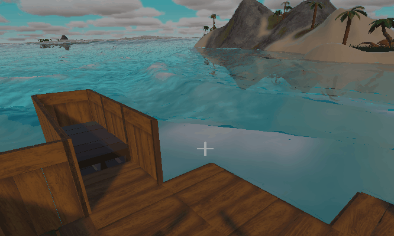
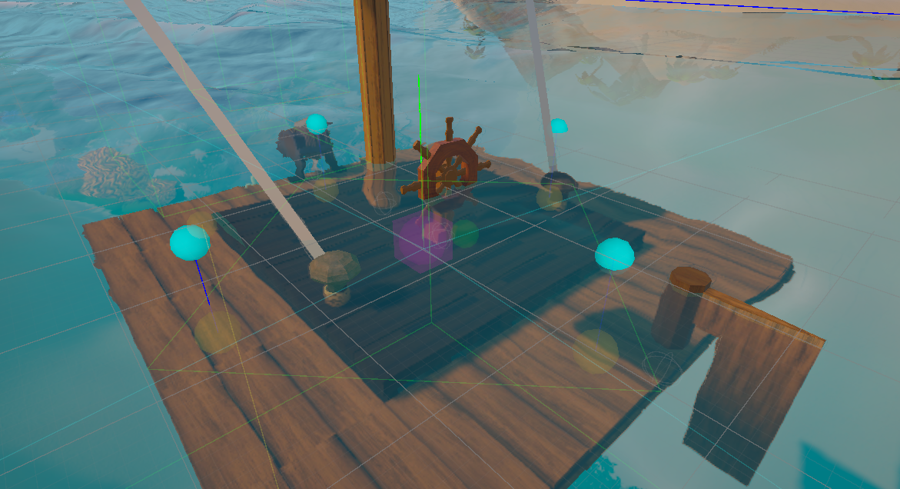
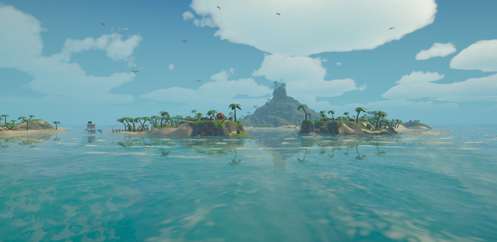
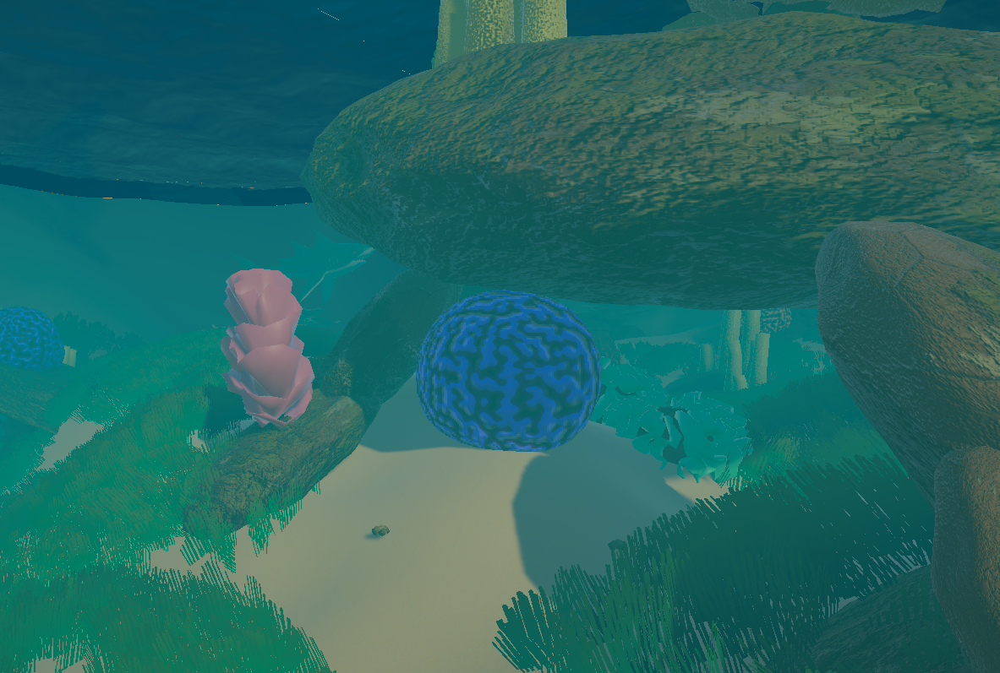
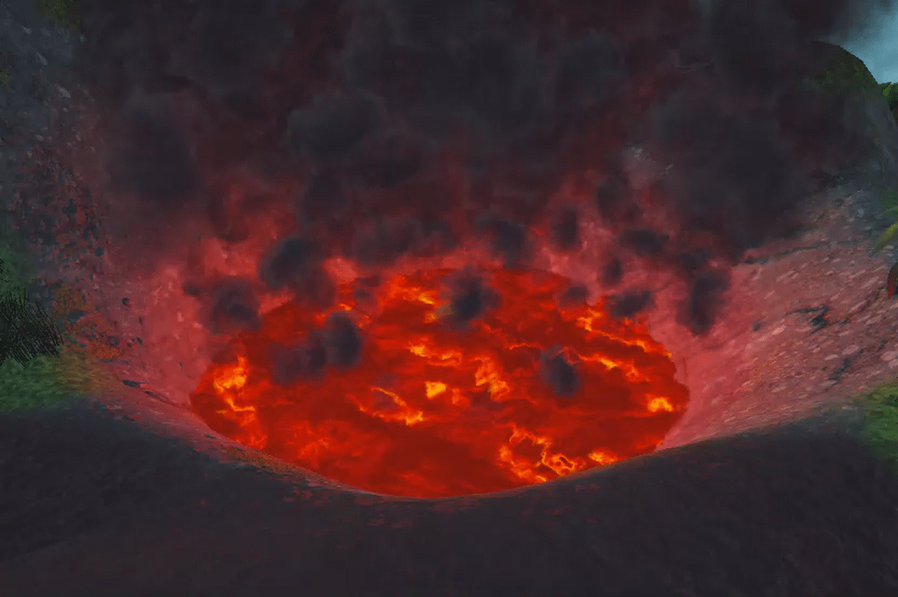
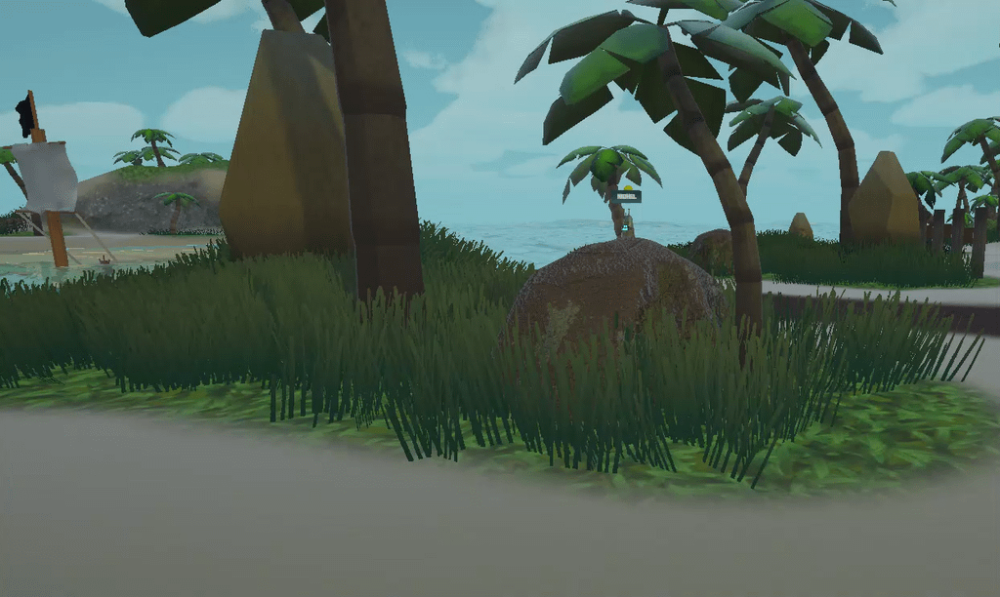
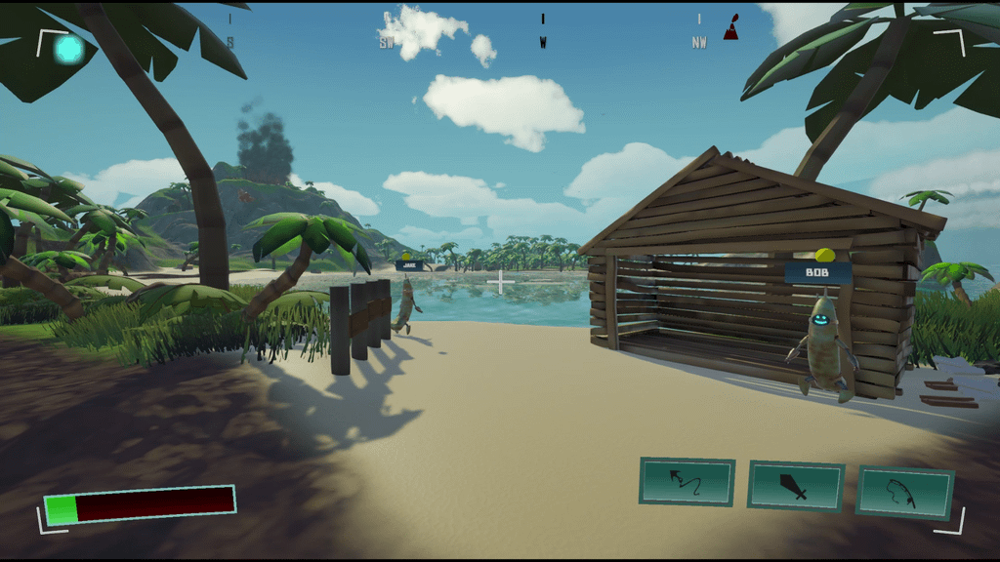
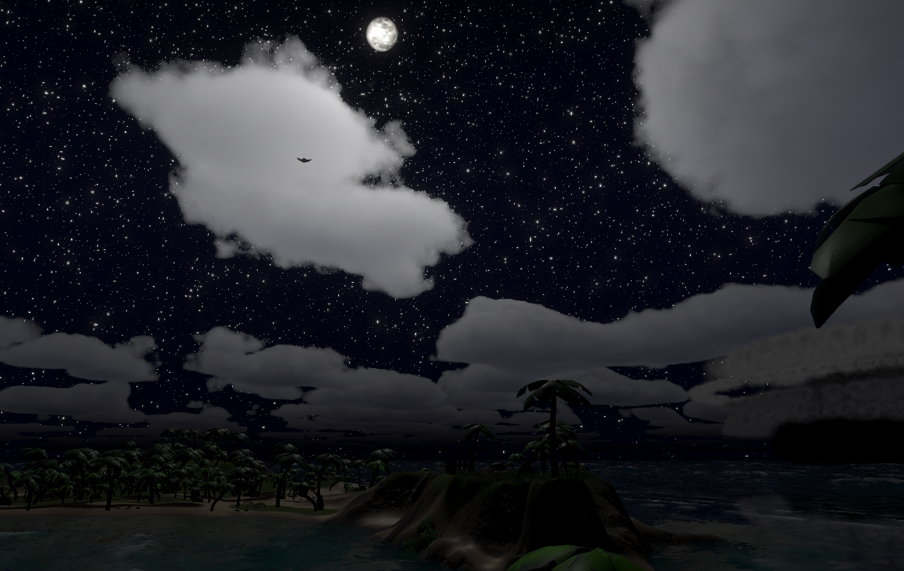
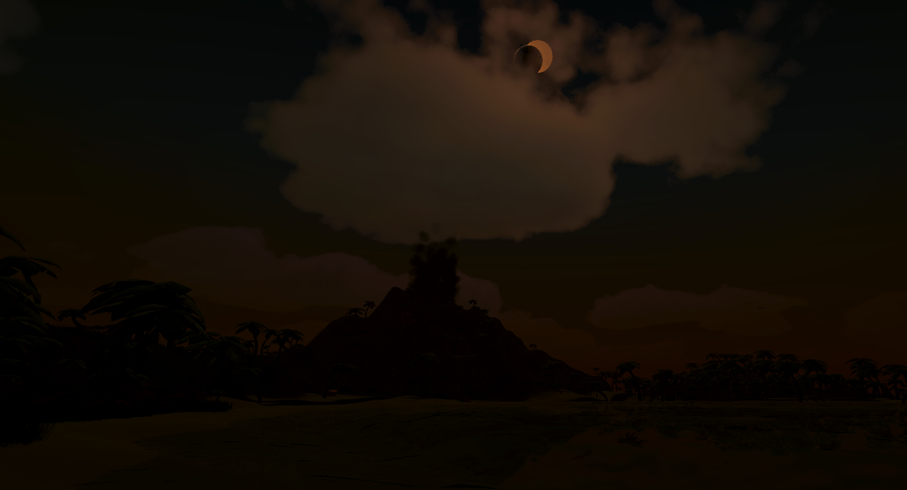

<!--==================================================
  The Game 
==================================================-->
<!-- lang:fr -->
## Le Jeu

**Fish and Ship** est un jeu de simulation de type friend-slop, conçu pour un public occasionnel (12 ans et plus). Développé sous Unity, il est jouable exclusivement sur PC.

Pitch :
Explorez, améliorez votre équipement et collectez toutes les créatures de l'océan.

Objectifs :
Vous incarnez un robot déployé par un vaisseau-mère. Votre mission est de construire et d'améliorer votre bateau pour parcourir les mers et capturer les espèces qui les peuplent, tout en prenant garde aux créatures dangereuses. Vous avez également la possibilité d'aider d'autres robots envoyés par le vaisseau-mère en accomplissant leurs quêtes.

<!-- /lang -->
<!-- lang:en -->
## The Game

**Fish and Ship** is a casual simulation game designed for an occasional audience (ages 12 and up). Developed using Unity, it is playable exclusively on PC.

Pitch:
Explore, upgrade your equipment, and collect all the creatures in the ocean.

Objectives:
You play as a robot deployed by a mothership. Your mission is to build and upgrade your boat to sail the seas and capture the species that inhabit them, all while watching out for dangerous creatures. You also have the opportunity to help other robots sent by the mothership by completing their quests.
<!-- /lang -->

<!--==================================================
  My tasks
==================================================-->
<!-- lang:fr -->
## Mes tâches

Sur ce projet, j'ai été en charge de diverses tâches, mon travail principale étant la gestion du bateau modulaire ainsi que de sa physique.

<!-- /lang -->
<!-- lang:en -->
## My tasks

On this project, I was responsible for a variety of tasks, with my primary focus being the management of the modular boat and its physics.

<!-- /lang -->
<!--==================================================
  The Project 
==================================================-->
<!-- lang:fr -->
## Le bateau

**Construction modulaire :**

La conception modulaire du bateau a représenté la tâche la plus complexe, notamment parce que celui-ci devait être répliqué chez tous les joueurs en mode multijoueur, et qu'il ne possède ni position ni orientation fixes (problème de synchronisation lié à la latence de transmission des données entre les joueurs).

**Physique :**

Une fois la construction du bateau terminée, je me suis occupé d'implémenter une physique réaliste, que ce soit la flottaison sur l'eau en prenant en compte le comportement de l'eau, cette dernière étant basée sur un algorithme de Transformation de Fourier Rapide (FFT).

Pour la flottaison, j'ai utilisé une flottabilité multi-points, avec 4 points. Lors de la construction, le centre de gravité du navire est calculé en fonction du poids et de la position de chaque élément (un bateau mal équilibré peut se retourner, mais ne peut pas couler totalement).

Une fois le centre de gravité déterminé, les quatre points de flottaison sont calculés de manière à être les plus éloignés possible du centre et entre eux, tout en restant au même niveau de hauteur que le centre de gravité.

Pendant la simulation, des forces sont appliquées verticalement (poussée d'Archimède) afin de reproduire le mouvement de l'objet sur l'eau, simulant ainsi le tangage et le roulis du bateau. 
Le joueur utilise le même système de flottaison que le navire.

**Mouvement :**

Pour se déplacer, le bateau s'appuie sur les voiles, la barre et l'ancre.

Les déplacements se basent sur une simulation physique tirée de la navigation à la voile. Le mouvement du navire est déterminé par l'angle de la voile (qui peut être pivoté par les joueurs à bord) et la direction du vent. Le bateau prenant en compte les différentes positions comme sur un voilier (le près, le travers, le vent debout, le large, etc.).

Cela rend donc impossible de naviguer directement contre le vent et obligeant les joueurs à manoeuvrer à la fois leur navire et les voiles.

Pour la direction du bateau, sa taille et son poids sont importants, permettant à un petit bateau d'être vif et rapide, alors qu'un grand bateau aura tendance à tourner lentement.

L'ancre diminue progressivement la vitesse du bateau jusqu'à s'arrêter totalement.

**Mouvement du joueur sur le bateau**

Lorsque nous avons commencé à tester le fonctionnement du bateau avec les joueurs dessus, nous nous sommes aperçus que, malgré la friction de base de Unity entre les objets, les joueurs avaient du mal à rester sur le bateau et étaient souvent laissés sur place par le bateau, du fait de sa vitesse supérieure à celle de la friction du personnage. 

Plusieurs choses ont été essayées, comme attacher le joueur comme un enfant du bateau, mais cette technique avait des complications pour détecter quand le joueur montait et descendait du bateau.

La solution finale a consisté à créer un faux bateau invisible et à un autre endroit, qui est à un emplacement précis et sans rotation. 

Nous utilisons un raycast venant du joueur lorsque celui-ci est hors du bateau, ainsi qu'un raycast venant d'un joueur fictif sur le faux bateau, dans le but de déterminer si le bateau se trouve sous le joueur ou non.

Le faux bateau nous a permis de simuler la physique des joueurs sur celui-ci, et de déplacer le joueur à la bonne position et orientation sur le vrai navire. Ce qui a permis de reproduire les mêmes déplacements et orientations que le navire lorsqu'il est en mouvement.

<!-- /lang -->
<!-- lang:en -->
## The Boat

**Modular Construction:**

The boat's modular design was the most complex challenge, particularly because it had to be replicated for all players in multiplayer mode and because it has no fixed position or orientation (a synchronization issue caused by latency in data transmission between players).

**Physics:**

Once the boat was built, I worked on implementing realistic physics, including how the boat floats on water while taking into account the behavior of the water, which is based on a Fast Fourier Transform (FFT) algorithm.

For buoyancy, I used a multi-point buoyancy system with four points. During construction, the ship’s center of gravity is calculated based on the weight and position of each component (an unbalanced boat can capsize but cannot sink completely).

Once the center of gravity is determined, the four buoyancy points are calculated to be as far apart as possible from the center and from each other, while remaining at the same height as the center of gravity.

During the simulation, vertical forces (Archimedes’ principle) are applied to reproduce the object’s movement on the water, thereby simulating the boat’s pitch and roll.

The player uses the same buoyancy system as the ship.

**Movement:**

To move, the boat relies on its sails, rudder, and anchor.

Movement is based on a physics simulation derived from sailing. The ship’s movement is determined by the angle of the sail (which can be adjusted by the players on board) and the direction of the wind. The ship accounts for different positions, just like on a sailboat (close-hauled, beam reach, broad reach, running, etc.).

This makes it impossible to sail directly into the wind, forcing players to maneuver both their ship and the sails.

When it comes to steering the ship, its size and weight are important factors: a small ship is nimble and fast, while a large ship tends to turn slowly.

The anchor gradually slows the ship down until it comes to a complete stop.

**Player Movement on the Boat**

When we began testing how the boat worked with players on board, we realized that, despite Unity’s default friction between objects, players had trouble staying on the boat and were often left behind because the boat’s speed exceeded the character’s friction.

We tried several approaches, such as attaching the player to the boat like a child, but this technique made it difficult to detect when the player was getting on or off the boat.

The final solution was to create an invisible dummy boat in a different location, positioned at a specific spot and with no rotation.

We use a raycast originating from the player when they are off the ship, as well as a raycast originating from a fictional player on the dummy ship, to determine whether the ship is beneath the player or not.

The dummy boat allowed us to simulate the players’ physics on it and to move the player to the correct position and orientation on the real ship. This made it possible to replicate the same movements and orientations as the ship when it is in motion.

<!-- /lang -->
<!--==================================================
  The Environment
==================================================-->
<!-- lang:fr -->
## L'environnement

**Conception de l'environnement :**

Pour l'environnement, nous avons utilisé l'outil **Terrain** d'Unity, ce qui nous a permis de façonner rapidement le relief et de créer les différentes îles du jeu. J'ai pris en charge le terraforming complet ainsi que le placement des éléments de décor de l'île principale et d'une partie des fonds marins.

**Shaders :**

| Magma | Grass | Grass |
| :---: | :---: | :---: |
|  |  |  |

Afin d'améliorer l'immersion et d'apporter davantage de dynamisme, nous avons intégré divers effets visuels. J'ai développé plusieurs shaders, notamment un shader de magma, un shader d'herbe ainsi qu'un effet d'explosion lors de la mort du joueur. Ces outils nous ont permis de générer des effets visuels directement en code ou Shader Graph, sans dépendre de textures ou d'animations complexes, ce qui a représenté un gain de temps considérable durant le développement.

**Ciel et cycle jour-nuit :**

| Night | Eclipse |
| :---: | :---: |
|  |  |

Pour la skybox du jeu, j'ai fait le choix de la créer entièrement via un shader unique, contrôlable par script. Concernant la luminosité, il a été nécessaire de piloter la lumière principale de la scène afin d'obtenir un rendu nocturne cohérent.

Le shader de la skybox a été conçu pour permettre une évolution progressive des couleurs du ciel en fonction de l'heure. Il intègre également les différentes phases lunaires, faisant varier l'apparence de la lune au fil des cycles, avec la possibilité de générer des éclipses.

Pour gérer l'éclairage global, j'ai utilisé le système de Main Light d'Unity, ce qui permet de synchroniser la position, l'orientation et l'intensité de la lumière avec le cycle jour-nuit.

<!-- /lang -->
<!-- lang:en -->
## The Environment

**Environment Design:**

For the environment, we used Unity’s **Terrain** tool, which allowed us to quickly shape the terrain and create the game’s various islands. I handled all the terraforming as well as the placement of environmental elements on the main island and part of the seabed.

**Shaders:**

| Magma | Grass | Grass |
| :---: | :---: | :---: |
|  |  |  |

To enhance immersion and add more dynamism, we incorporated various visual effects. I developed several shaders, including a magma shader, a grass shader, and an explosion effect that triggers when the player dies. These tools allowed us to generate visual effects directly in code or Shader Graph, without relying on textures or complex animations, which saved us a considerable amount of time during development.

**Sky and Day-Night Cycle:**

| Night | Eclipse |
| :---: | :---: |
|  |  |

For the game’s skybox, I chose to create it entirely using a single, script-controllable shader. Regarding brightness, it was necessary to control the scene’s main light source in order to achieve a consistent nighttime rendering.

The skybox shader was designed to allow for a gradual change in sky colors based on the time of day. It also incorporates the different lunar phases, varying the moon’s appearance throughout its cycles, with the ability to generate eclipses.

To manage the overall lighting, I used Unity’s Main Light system, which allows me to synchronize the light’s position, orientation, and intensity with the day-night cycle.

<!-- /lang -->