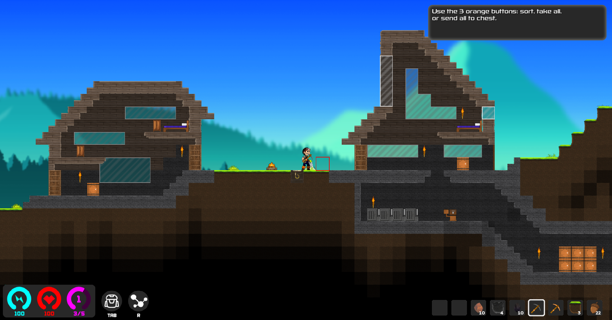
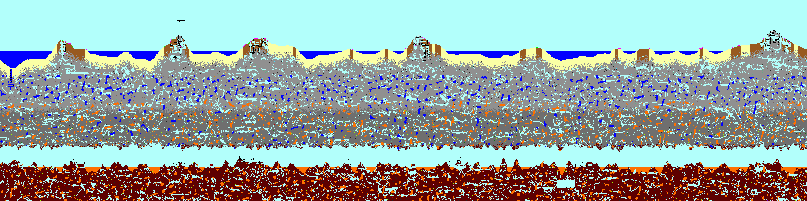

---
# Second example project. Copy this file to create your own:
# rename it, change the frontmatter, write the body. That is all.

title_fr: Godbreak
title_en: Godbreak

summary_fr: Bac à sable et Génération procédurale
summary_en: Sandbox and Procedural Generation

alt_fr: _
alt_en: _

image: ./Godbreak/GodbreakIcon.png

tags: [C++, SFML, Tools]

date: 2025-01-01

repo: https://www.creajeux.fr/projet/godbreak/
---

<!--==================================================
  The Game
==================================================-->
<!-- lang:fr -->
## Le Jeu

GodBreak est un jeu de type bac à sable, développé en SFML et disponible uniquement sur PC. Le jeu comprend un système de construction et de fabrication, ainsi que du combat contre des monstres et des boss.
L'objectif du jeu consiste à explorer, bâtir un monde à son image et affronter le créateur de ce monde.

Mon travail effectué sur ce projet :
– Création du monde de manière procédurale. Génération du terrain, des structures et du contenu des coffres trouvable dans les structures.
– Gestion du système de construction.
– Sauvegarde du monde sous forme de chunk et des inventaires.

En cours d'écriture…

<!-- /lang -->
<!-- lang:en -->
## Le Jeu

GodBreak est un jeu de type bac à sable, développé en SFML et disponible uniquement sur PC. Le jeu comprend un système de construction et de fabrication, ainsi que du combat contre des monstres et des boss.
L'objectif du jeu consiste à explorer, bâtir un monde à son image et affronter le créateur de ce monde.

Mon travail effectué sur ce projet :
– Création du monde de manière procédurale. Génération du terrain, des structures et du contenu des coffres trouvable dans les structures.
– Gestion du système de construction.
– Sauvegarde du monde sous forme de chunk et des inventaires.

En cours d'écriture…

<!-- /lang -->