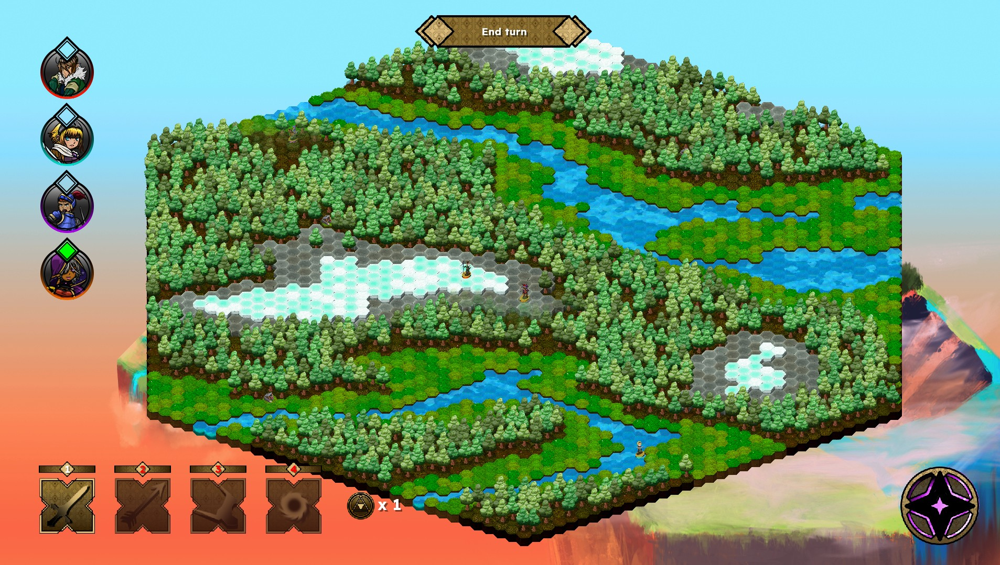
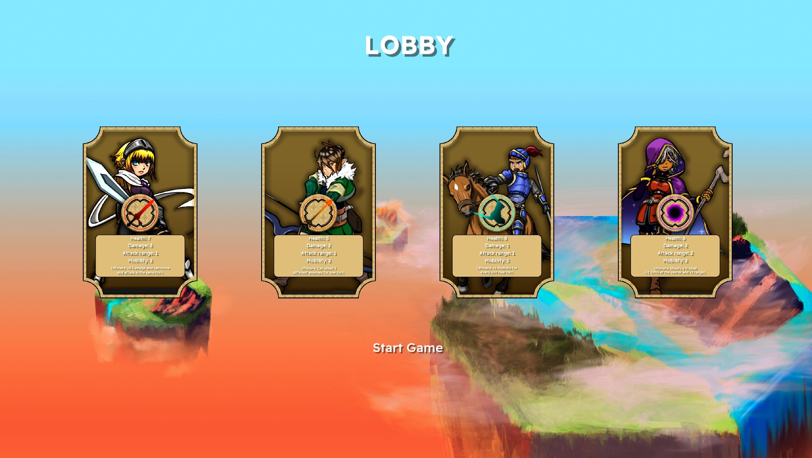

---
# Second example project. Copy this file to create your own:
# rename it, change the frontmatter, write the body. That is all.

title_fr: Hexatak
title_en: Hexatak

summary_fr: Tour par tour en multijoueur
summary_en: Turn-by-turn multiplayer

alt_fr: _
alt_en: _

image: ./Hexatak/HexatakIcon.jpg

tags: [C++, SFML, LAN]

date: 2025-01-01
---

<!--==================================================
  The Game
==================================================-->
<!-- lang:fr -->
## Le Jeu

Hexatak est un jeu multijoueur au tour par tour, conçu en SFML et exclusivement accessible sur ordinateur.
La maquette du jeu a été réalisée en carton pour la tester en tant que jeu de société physique et confirmer ainsi les règles du jeu.

Le jeu propose quatre héros, chacun doté d'une caractéristique distinctive et d'une compétence exclusive. Chaque participant a la possibilité de disposer des unités sur le plateau de jeu. Il y a quatre classes présentes dans le jeu : guerrier, archer, chevalier et mage. Chaque pièce a un coût lorsqu'elle est placée sur le plateau.

Sur ce projet, ma tâche a consisté à gérer les attaques et les déplacements des unités. Le type de terrain affecte le nombre de cases sur lesquelles on peut se déplacer ainsi que la portée d'attaque des unités.
Par exemple, une unité ne peut pas se déplacer directement d'une plaine à une montagne. Elle est obligée de passer par une case intermédiaire. Sur la neige et dans la forêt, les mouvements des unités sont restreints, tandis que dans l'eau, elles ne peuvent progresser que d'une seule case à chaque tour.

En cours d'écriture…

<!-- /lang -->
<!-- lang:en -->
## Le Jeu

Hexatak is a turn-based multiplayer game, developed in CSFML and available exclusively on computers.
A cardboard prototype of the game was created to test it as a physical board game and thereby confirm the game rules.

The game features four heroes, each with a distinctive trait and a unique ability. Each player can place units on the game board. There are four classes in the game: warrior, archer, knight, and mage. Each unit has a cost when placed on the board.

For this project, my task was to manage unit attacks and movements. The type of terrain affects the number of spaces a unit can move and its attack range.
For example, a unit cannot move directly from a plain to a mountain. It must pass through an intermediate square. On snow and in the forest, unit movement is restricted, while in water, units can only move one square per turn.

Currently being written…

<!-- /lang -->