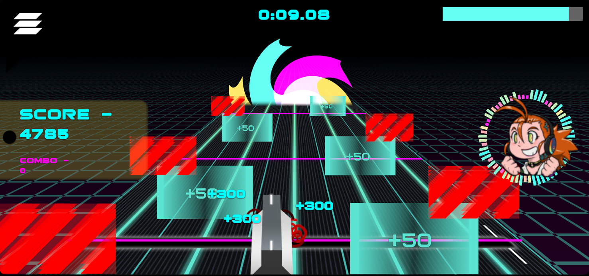
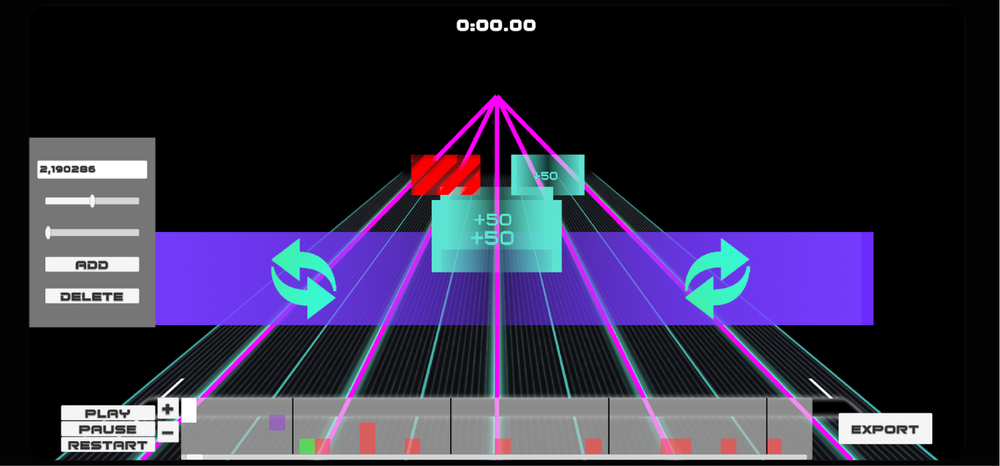

---
# Second example project. Copy this file to create your own:
# rename it, change the frontmatter, write the body. That is all.

title_fr: Pulse
title_en: Pulse

summary_fr: Jeu de mussique et editeur de niveaux.
summary_en: Music game and level editor.

alt_fr: _
alt_en: _

image: ./Pulse/PulseIcon.png

tags: [C#, Unity, Tools]

date: 2025-09-01
---

<!--==================================================
  The Game
==================================================-->
<!-- lang:fr -->
## Le Jeu

Pulse est un jeu de rythme mobile développé sous Unity. Il comprend deux modes de jeu ainsi qu'un système de gacha permettant d'obtenir des bonus pour les différentes parties et modes.

Un premier mode de jeu consiste à cliquer sur les notes ou à bouger son téléphone dans le bon sens au bon timing. Le second mode consiste à déplacer un slider de gauche à droite pour traverser des portiques de notes, tout en évitant les murs, certains portiques peuvent également inverser la direction.

Mon travail effectué sur ce projet :
- Création du deuxième mode de jeu.
- Création d'un éditeur de niveau dédié au deuxième mode avec timeline, afin d'avoir un aperçu direct du rendu en jeu.

En cours d'ecriture...

<!-- /lang -->
<!-- lang:en -->
## The Game

Pulse is a mobile rhythm game developed using Unity. It features two game modes as well as a gacha system that lets you earn bonuses for different levels and modes.

The first game mode involves tapping notes or moving your phone in the right direction at the right time. The second mode involves moving a slider from left to right to pass through note gates while avoiding walls; some gates can also reverse the direction.

My work on this project:
- Creation of the second game mode.
- Created a level editor dedicated to the second mode, complete with a timeline, to provide a direct preview of how the level will look in-game.

Currently being written...

<!-- /lang -->