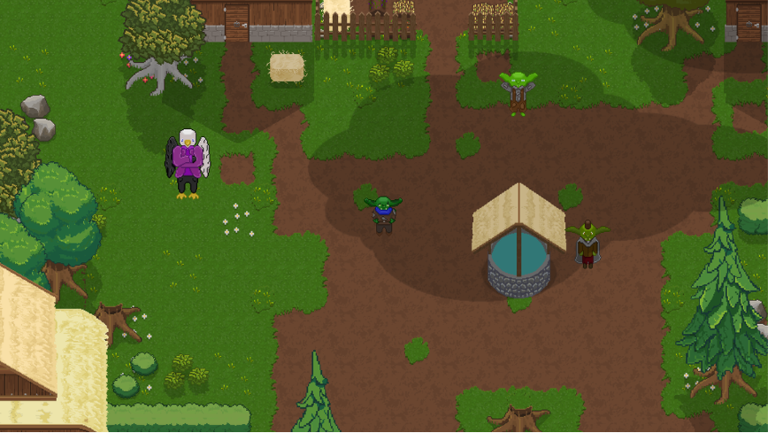
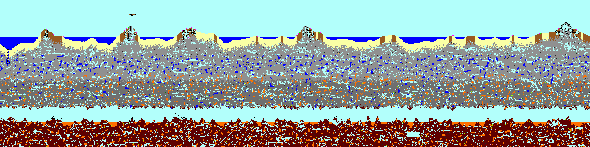

---
# Second example project. Copy this file to create your own:
# rename it, change the frontmatter, write the body. That is all.

title_fr: SlumberQuest
title_en: SlumberQuest

summary_fr: Jeu tour par tour
summary_en: Turn-based game

alt_fr: L'éditeur avec ses trois panneaux et un chemin de navigation.
alt_en: The editor with its three panels and a navigation path.

image: ./SlumberQuest/SlumberQuestIcon.jpg

tags: [Lua, Love2D]

date: 2023-01-01
---

<!--==================================================
  The Game
==================================================-->
<!-- lang:fr -->
## Le Jeu

SlumberQuest

Mon travail effectué sur ce projet :
- 

En cours d'écriture…

<!-- /lang -->
<!-- lang:en -->
## Le Jeu

SlumberQuest

My contributions to this project:
– 

Currently being written...

<!-- /lang -->